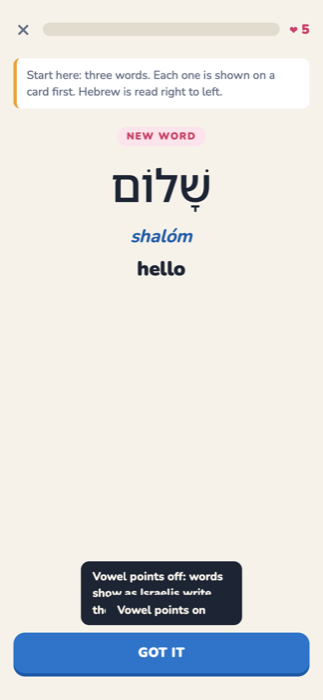
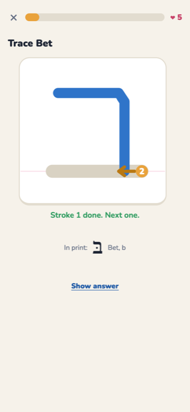
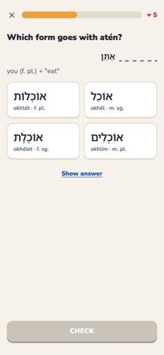

# Ivrit · עִבְרִית

A free, bite-sized course in modern Israeli Hebrew, in the browser. No account, no build step.

**Live:** https://cveenstra.github.io/ivrit/

<p>
  
  
  
</p>

- **Gentle start.** Every new word or letter is met on a card first; lessons add 3–4 new items. **Show answer** on every question costs no heart and sends the item to Review.
- **Letters course.** The 22 letters, 5 final forms, dot/no-dot pairs and vowel points (niqqud) a few at a time: letter ↔ sound, reading syllables, then real words using only what you have learned. Drills for look-alike letters, final forms and dagesh. Strength meter per letter.
- **Tracing.** Draw each print letter stroke by stroke over a guide, from the gold dot along the arrow. Strokes are scored on how closely they follow the guide and their direction; after two misses the stroke is animated as a hint.
- **Niqqud toggle.** Vowel points are on by default; switch them off to read Hebrew the way Israelis write it. Every word stores both spellings.
- **Grammar that matters early.** Present-tense verbs and adjectives agree in gender and number; "which form goes with…" questions drill it. Informal words (yalla, sababa) are labelled.
- **Exercises:** Hebrew → English, English → Hebrew, pick the reading, type the reading, match pairs, build a sentence (right to left), tap-to-gloss sentences, listening (only when the device has a Hebrew voice), flashcards, spaced review.
- **Progress** is saved in the browser; in the private claude.ai version it is also saved to your account.

## Accuracy

Words, spellings with and without points, transliterations and genders come from English Wiktionary; letters and vowel points from Wikipedia. See [SOURCES.md](SOURCES.md) for the method, what is generated by rule, what was composed for the course, and everything left out.

```
python3 scripts/wikt.py           # fetch / refresh the Wiktionary cache
python3 scripts/build_letters.py  # letters and vowels from Wikipedia
python3 scripts/build_data.py     # words, verb and adjective forms, sentences
python3 scripts/build_tracing.py
python3 scripts/build_course.py
python3 scripts/build_sources.py
node scripts/check-data.mjs       # validates the data
node scripts/check-questions.mjs  # generates every lesson and checks each question
```

Code: MIT. Course data: CC BY-SA 4.0 (see LICENSE).
